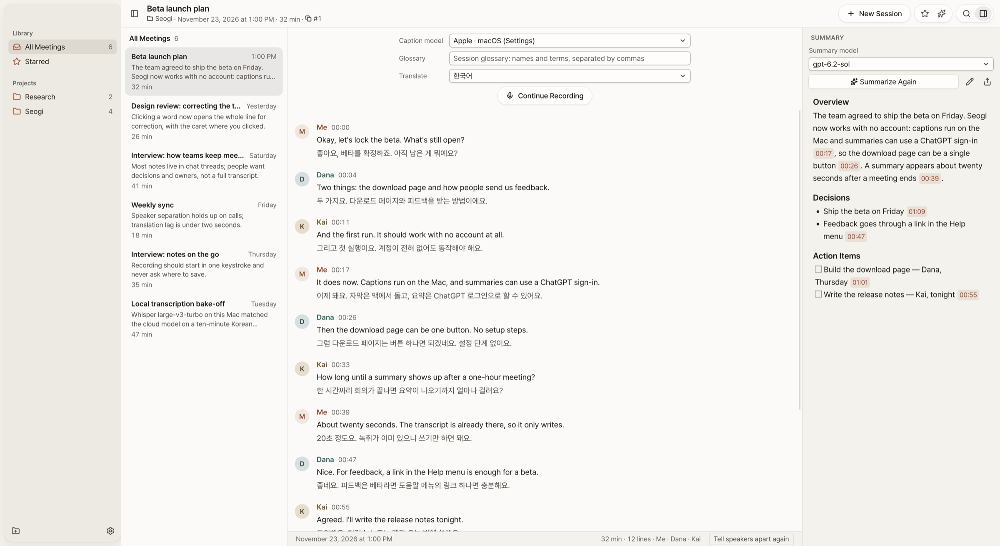

<h1 align="center">Seogi</h1>

<p align="center">
  Meeting notes for macOS. It writes down what's said as people talk,<br>
  and has the notes ready when the meeting ends.
</p>

<p align="center">
  <a href="https://github.com/DongSeonYoo/seogi/releases/latest"></a>
</p>

<p align="center">
  <sub>Apple silicon · macOS 14.2 or later · free and open source</sub>
</p>

<br>

<picture>
  <source media="(prefers-color-scheme: dark)" srcset="assets/readme/screenshot-dark.png">
  
</picture>

<br>

*Seogi* (서기) is Korean for the person who takes the minutes.

## What it does

- **Both sides of the call.** Your microphone and the computer's audio are recorded as separate tracks, so the transcript knows what you said and what came through the call. Voices on the other side are told apart automatically. Name one once and every line by that voice follows.
- **Notes when you stop.** An overview, the decisions, and action items with owners and due dates. Every point links back to the moment it was said.
- **Translation under each line**, while the meeting is still going.
- **Find it later.** ⌘K searches every meeting, words in any order, Korean initials too (ㅎㅂㅇㅈ finds 헤비 유저). ⌘F searches the open one.
- **Fix as you read.** Click a word to correct its line where it stands, or play from any line to hear it.
- **Bring a recording.** Import an m4a, mp3, wav or mp4 file and it is transcribed the same way.

## No account needed

| | Runs on | Options |
|---|---|---|
| Live captions | This Mac | Apple's on-device speech recognition (macOS 26), Whisper large-v3-turbo (a 1.6 GB download in Settings), or an OpenAI API key |
| Notes and translation | Your plan or key | Sign in with ChatGPT (Plus or Pro), or an OpenAI or Anthropic API key |

Meetings, audio and settings stay in `~/Library/Application Support/Seogi`. API keys are encrypted with the macOS keychain.

## For agents

Seogi ships a read-only `seogi` command and a skill for Claude Code and Codex. Choose **Seogi › Install Command and Agent Skill…**, then ask your agent about `#51` or "yesterday's design review".

```sh
seogi list                          # meetings, newest first
seogi search "release notes"        # lines that hold all the words
seogi show 51 --from 12:00          # notes and transcript, or a span of it
seogi follow                        # the meeting being recorded, as it is said
```

Answers cite lines as `seogi://meeting/51?t=12:34` links, which open Seogi at that line.

## Install

1. Download the latest release and move **Seogi.app** to Applications.
2. Seogi is not notarized yet, so macOS stops the first launch. Open **System Settings › Privacy & Security** and choose **Open Anyway**.
3. On the first recording, allow the microphone and **Screen & System Audio Recording**.

## Build from source

```sh
mise install
mise exec -- pnpm install
mise run dev        # run it
mise run check      # typecheck, tests and build
```

The design system lives in [`design.md`](design.md). In development, ⌘⇧D opens the living style guide.

## License

[Apache 2.0](LICENSE)
